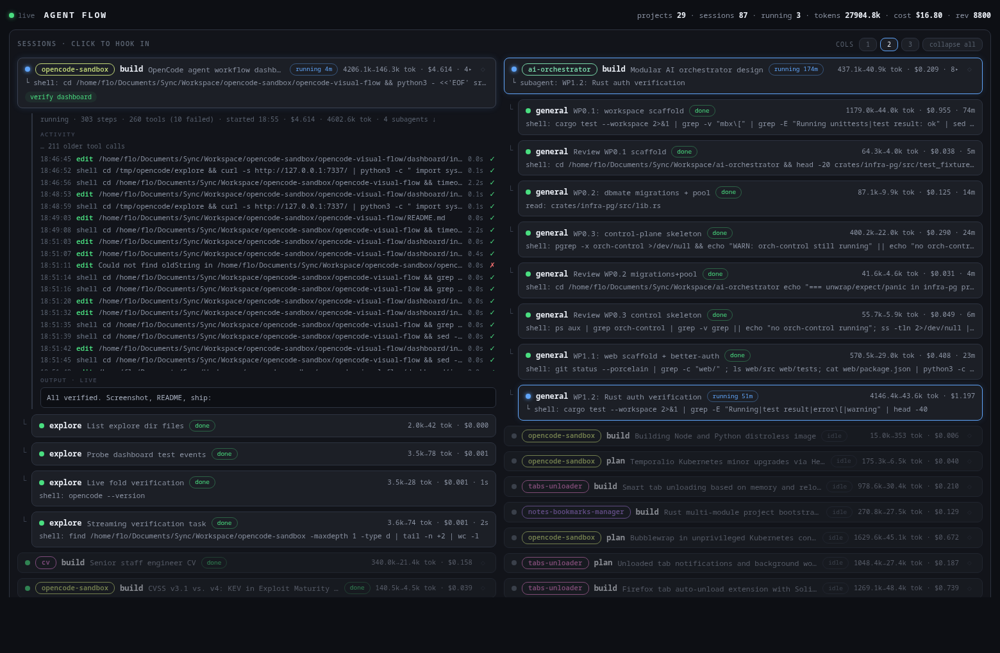

# opencode-visual-flow

[](https://www.npmjs.com/package/opencode-visual-flow)
[](LICENSE)

Live HTML dashboard for [OpenCode](https://opencode.ai) — **agent flow, cooperation, and task progression**. Every running session at a glance; click any session to hook in and watch tool calls and assistant output stream in real time.



One OpenCode plugin, zero build step. The plugin runs inside the OpenCode server process, folds the event stream into a small graph model, exposes it over RPC, and serves the dashboard from a local sidecar — the browser needs no token and no CORS setup.

## What it shows

- **Sessions grid** — one configurable grid (1/2/3 columns, persisted). Busy trees are **dispatched whole, round-robin onto the column tops**; any column that would still lack live content gets a **`LIVE` runner card** — a pointer to an uncovered running session (click it to hook into that feed) — while the session stays rendered inside its tree. The remaining list fills each column as a contiguous run: running/waiting first (never truncated), then recently active, then older sessions as compact dimmed cards. Subagents render indented under their parent with the spawn (`└`) marker; a session never spans two columns.
- **Pinning** — every root card has a pin toggle (`◇`/`◆`): pinned sessions float to the top of the grid in pin order with an accent border, survive reloads, and render full-depth even when stale.
- **Per-card glance** — status dot + chip, colored project badge (click to filter), agent, title, tokens and cost, duration, current action (the tool running right now), `flow_task` chips, reviewer/critic `⌘ VERDICT` and `⚑` lines, errors.
- **Hook in** — click a session to expand a live feed in place:
  - summary line: status · steps · tools · started · cost · tokens · permission asks · subagent count
  - per-session tool-call timeline: time, tool, detail, duration, ✓/✗/●
  - **live output** — the streaming assistant text, auto-following the tail
  - subagent sessions below can be hooked into as well
- **`collapse all`** — one click closes every open feed.
- **Deep links** — `?expand=<sessionID>` opens feeds directly; `?static=1` renders a single snapshot with no live loop (embedding/screenshots).
- Streaming is event-driven: the plugin pushes per-session activity over the existing event stream; hooked feeds update with no full-page refresh, and everything else reconciles in the background.

## Install

Requires OpenCode **v2.1+**.

```jsonc
// opencode.json
{
  "$schema": "https://opencode.ai/config.json",
  "plugins": ["opencode-visual-flow"]
}
```

Or from a local checkout:

```jsonc
{ "plugins": ["/absolute/path/to/opencode-visual-flow"] }
```

Reload the location (or restart OpenCode) and open:

```
http://127.0.0.1:7337
```

The sidecar binds loopback only (IPv4 + IPv6) and falls back `+1..+20` if the port is taken. The actual URL is logged as `[flow] dashboard at …` and written to `~/.local/state/opencode/flow-dashboard.json`.

## The `flow_task` tool

The plugin registers a namespaced tool agents call to materialize cooperative task progression:

```
flow_task({ action: "start" | "progress" | "done" | "fail", task: "short title", detail?: "one line" })
```

Entries land on the calling session's row and survive restarts. Add a line to your agent prompts (or workflow instructions) telling agents to declare tasks; anything they don't declare still renders from observed tool activity.

## How it works

```
opencode service ──(event stream)──► plugin reducer ──► RPC  flow.snapshot / flow.changed / flow.activity
                                          │
                     browser ◄── sidecar (127.0.0.1:7337) ──► opencode /api/*
```

- `src/flow.ts` — pure reducer: V2 events → `{ nodes, edges, ticks, tasks }`. `session.created` builds the session tree (`parentID` → spawn edge), `execution.*` drives status, `tool.*` builds the activity ticks, `text.delta` feeds the live output, `usage.updated` accumulates tokens/cost, reviewer output is mined for verdicts.
- `src/index.ts` — plugin setup: hydrate the persisted model (`ctx.storage`), backfill all sessions (`ctx.session.list()` across every location the service hosts), subscribe to events, register the RPC + `flow_task` tool, run the sidecar.
- `src/sidecar.ts` — node:http sidecar: serves `dashboard/index.html`, proxies `/api/*` with credentials read (and watched) from `~/.local/state/opencode/service.json`, and injects the plugin's location into RPC routes.

Other clients can consume the same RPC:

```ts
import { OpenCode } from "@opencode/client"
import { Flow } from "opencode-visual-flow/rpc"

const client = OpenCode.make({ baseUrl: "http://127.0.0.1:49374" })
const flow = client.rpc(Flow)
const model = await flow.snapshot({}, { location: { directory: "/path/to/project" } })
flow.events.on("activity", (e) => console.log(e.data.kind, e.data.sessionID))
```

Or plain HTTP: `POST /api/rpc/flow/snapshot?location[directory]=<dir>` with `{"input":{}}` → `{"output": <model>}`.

## OpenCode loader gotchas

Learned the hard way on v2.1.4, documented here so you don't have to:

- Plugin paths in `plugins` must be **absolute** — relative entries are treated as npm packages and silently dropped.
- A local directory plugin resolves convention entrypoints at its root: `server.ts` (server feature), `rpc.ts` (RPC contract), `tui.ts` (TUI). The `package.json` `exports` map is **not** consulted for directory plugins.
- RPC HTTP routes are **location-scoped**: `POST /api/rpc/{id}/{method}?location[directory]=<dir>`. The sidecar injects this automatically.

## Development

```
bun install
bun run replay [events.jsonl]   # replay a captured event stream through the reducer
```

`scripts/replay.ts` folds a JSONL event capture through the store and prints the resulting model — reducer changes without live traffic.

## License

[MIT](LICENSE)